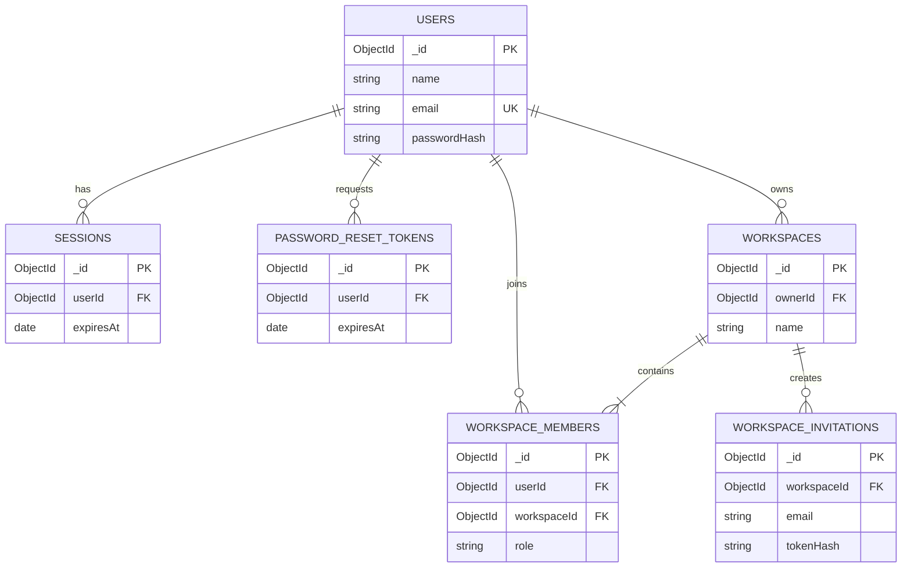
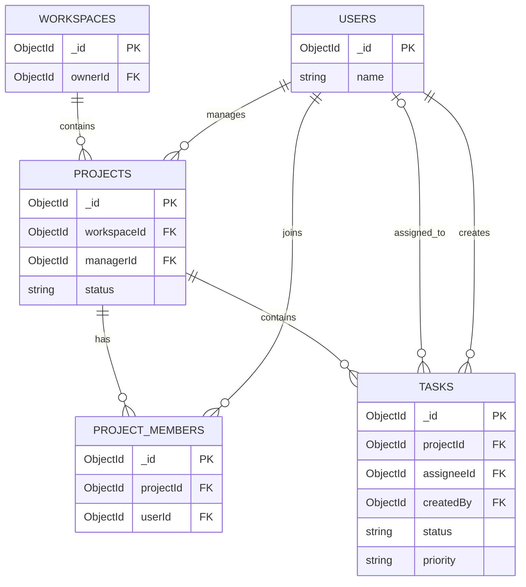

# DevFlow — Detailed Database Design

The [MVP engineering decisions](engineering-notes/007-mvp-decisions.md#data-model-and-validation) summarize the nine implemented collections, their indexes, and the transaction boundaries used by the release.

**Version 1.0 — Draft for Approval**

This document defines the MongoDB database for the approved **DevFlow Stage 1 MVP**.

The design uses **nine collections**, with MongoDB ObjectIds for relationships, Mongoose for data modeling, and transactions for operations that must update several collections together.

The main design goal is to keep the database simple enough to learn and build independently, while maintaining strong data consistency and security.

## 1. Database relationship diagrams

### Diagram A — Users and workspaces

### Diagram B — Workspaces, projects, and tasks

`PK` means primary key, `FK` means a stored reference to another collection, and `UK` means a unique key. MongoDB references do not automatically enforce foreign-key constraints; the backend must validate those relationships.

---

# DevFlow — Detailed MongoDB Database Design

**Project:** DevFlow  
**Development Stage:** Stage 1 — MVP  
**Document:** Database Design Specification  
**Version:** 1.0  
**Date:** November 13, 2026  
**Status:** Draft — Awaiting Approval  
**Database:** MongoDB  
**ODM:** Mongoose  
**Based On:** Approved Project Scope, SRS, and System Design

---

# 1. Introduction

## 1.1 Purpose

This document explains how DevFlow will store and manage its data using MongoDB.

It defines:

- Database collections.
- Fields and data types.
- Relationships between collections.
- Required and optional information.
- Database indexes.
- Data validation rules.
- Business rules.
- Transactions.
- Data deletion and access rules.
- Engineering decisions.

This document will guide the implementation of Mongoose schemas, repositories, services, and database tests.

## 1.2 Database Objectives

The database must:

1. Store user accounts securely.
2. Support multiple workspaces.
3. Allow users to join multiple workspaces with different roles.
4. Store projects belonging to workspaces.
5. Manage project membership.
6. Store development tasks.
7. Maintain valid relationships between records.
8. Prevent duplicate memberships.
9. Support task searching and filtering.
10. Provide data for the basic project dashboard.
11. Support authentication and password recovery.
12. Allow future DevFlow features without unnecessary database redesign.

## 1.3 Database Architecture

DevFlow Stage 1 will use a single MongoDB database named:

**devflow_db**

All workspaces will be stored in this database.

Workspaces will not have separate databases.

The application will use workspace membership and project membership checks to control which records a user can access.

The backend must enforce these rules for all protected operations.

---

# 2. Database Design Principles

## 2.1 MongoDB Document Model

MongoDB stores information as documents inside collections.

A collection is similar to a table in a relational database.

A document is similar to a record.

However, MongoDB supports nested objects and arrays, making it possible to store related information together.

DevFlow will use both embedded objects and references.

## 2.2 References vs. Embedded Data

We will use references for users, workspaces, projects, memberships, and tasks.

For example, a task will store the ID of its project instead of storing the complete project document.

This is useful because:

- Projects can contain many tasks.
- Tasks need independent updates.
- Users can belong to multiple workspaces.
- Membership records have their own permissions and lifecycle.
- Embedding every task inside a project could create very large documents.

Small information that belongs to only one document, such as basic user profile details, can be embedded.

## 2.3 Common Database Field Types

| Data Type | Purpose | Example |
|---|---|---|
| ObjectId | Identify a document or reference another document | User ID |
| String | Store text | Project name |
| Date | Store dates and timestamps | Task due date |
| Boolean | Store true/false values | Not needed as a major field initially |
| Object | Store small structured information | User profile |
| Enum | Restrict a string to allowed values | Task status |

An enum will be implemented as a string with an allowed set of values.

## 2.4 Common Fields

Every collection will have an `_id` field of type ObjectId.

Main business collections will also contain:

- `createdAt`: Date — when the record was created.
- `updatedAt`: Date — when the record was last updated.

Mongoose's timestamp feature can manage these values automatically.

Security-related collections will use the timestamps that are relevant to their lifecycle.

## 2.5 Optional Field Rules

An optional relationship, such as an unassigned task, will be represented using `null`.

An optional date will also use `null` when no date has been selected.

This provides a consistent way to query optional values.

---

# 3. Database Collections

The Stage 1 database will contain nine collections.

| No. | Collection | Purpose |
|---|---|---|
| 1 | `users` | User accounts |
| 2 | `sessions` | Authenticated user sessions |
| 3 | `password_reset_tokens` | Password recovery |
| 4 | `workspaces` | Company or team workspaces |
| 5 | `workspace_members` | User roles in workspaces |
| 6 | `workspace_invitations` | Workspace invitations |
| 7 | `projects` | Software projects |
| 8 | `project_members` | Project membership |
| 9 | `tasks` | Development tasks |

Additional collections will only be introduced when later approved features need them.

---

# 4. Collection 1 — Users

**Collection Name:** `users`

## 4.1 Purpose

The users collection stores information about registered DevFlow users.

A user has one account but may belong to several workspaces.

## 4.2 Field Design

| Field | Type | Required | Description |
|---|---|---|---|
| `_id` | ObjectId | Yes | Unique user ID |
| `name` | String | Yes | Full name |
| `email` | String | Yes | Unique email address |
| `passwordHash` | String | Yes | Securely hashed password |
| `profile` | Object | No | Basic profile information |
| `createdAt` | Date | Yes | Account creation time |
| `updatedAt` | Date | Yes | Last account update |

The optional `profile` object may contain a short biography or other basic profile fields supported by the approved user interface.

It will not contain a separate user role.

## 4.3 Validation Rules

- Name cannot be empty.
- Name should contain 2–100 characters.
- Email must be in a valid format.
- Email must be unique.
- Email addresses must be normalized consistently before saving.
- Password hashes must not be empty.
- Password hashes must never be returned in ordinary API responses.

A minimum password length of 12 characters is recommended for the application. Password validation happens before hashing.

## 4.4 Relationships

One user can:

- Own several workspaces.
- Belong to several workspaces.
- Join several projects.
- Manage projects.
- Create and receive tasks.
- Have multiple sessions.
- Request password recovery.

## 4.5 Design Decisions

**Why is there no `role` field?**

A user's role belongs to a workspace, not their entire account.

For example, the same user may be a Project Manager in one workspace and a Developer in another.

Storing a single global role on the user would not support this correctly.

**Why store `passwordHash` instead of `password`?**

Passwords must be securely hashed before storage. The original password must not be recoverable from the stored value.

---

# 5. Collection 2 — Sessions

**Collection Name:** `sessions`

## 5.1 Purpose

This collection stores information about authenticated login sessions.

DevFlow will use server-side sessions and secure cookies.

## 5.2 Field Design

| Field | Type | Required | Description |
|---|---|---|---|
| `_id` | ObjectId | Yes | Session ID |
| `userId` | ObjectId | Yes | User who owns the session |
| `tokenHash` | String | Yes | Hash of session token |
| `expiresAt` | Date | Yes | Session expiration time |
| `createdAt` | Date | Yes | Session creation time |

## 5.3 How Sessions Work

1. A user logs in with valid credentials.
2. The backend generates a secure random session token.
3. The backend stores a hash of the token in MongoDB.
4. The browser receives the original token through a secure HTTP-only cookie.
5. Future protected requests use the cookie.
6. The backend verifies the token and checks session expiration.
7. Logout removes or invalidates the session.

## 5.4 Validation Rules

- `userId` must reference an existing user.
- Session tokens must be created using a cryptographically secure random generator.
- `tokenHash` must be unique.
- `expiresAt` must be later than the creation time.
- Expired sessions must not be accepted.

**Proposed session lifetime:** Seven days maximum, with expiration checked on every authenticated request.

## 5.5 Design Decisions

Server-side sessions were selected because the backend can invalidate a session immediately.

Only a token hash is stored in the database, reducing the risk from accidental disclosure of session records.

An expiration index can automatically clean up old sessions.

However, the application must check expiration itself and must not depend on automatic database cleanup for security.

---

# 6. Collection 3 — Password Reset Tokens

**Collection Name:** `password_reset_tokens`

## 6.1 Purpose

This collection stores secure temporary tokens used during password recovery.

## 6.2 Field Design

| Field | Type | Required | Description |
|---|---|---|---|
| `_id` | ObjectId | Yes | Record ID |
| `userId` | ObjectId | Yes | User requesting recovery |
| `tokenHash` | String | Yes | Hash of recovery token |
| `expiresAt` | Date | Yes | Expiration time |
| `usedAt` | Date / null | No | Time when token was used |
| `createdAt` | Date | Yes | Request creation time |

## 6.3 Password Recovery Process

1. A user requests password recovery.
2. The system generates a secure random token.
3. Only the hash is stored.
4. The user receives a password-reset link through email.
5. The user opens the link and enters a new password.
6. The backend verifies the token, expiration, and unused status.
7. The password is updated.
8. The reset token becomes invalid.
9. Existing authenticated sessions are invalidated.

## 6.4 Validation Rules

- A reset token must belong to an existing user.
- A token can only be used once.
- Expired tokens must be rejected.
- Tokens must not appear in logs.
- Token values must not be stored in plain text.

**Proposed reset-token lifetime:** 30 minutes.

## 6.5 Design Decisions

Password reset tokens are stored separately from user accounts because they are temporary security records.

The reset-token record and password update should be handled atomically so that a token cannot be used more than once.

---

# 7. Collection 4 — Workspaces

**Collection Name:** `workspaces`

## 7.1 Purpose

A workspace represents a company or software development team.

Examples:

- ABC Software.
- University Development Team.
- Startup Engineering Team.

A workspace can contain multiple projects and members.

## 7.2 Field Design

| Field | Type | Required | Description |
|---|---|---|---|
| `_id` | ObjectId | Yes | Workspace ID |
| `name` | String | Yes | Workspace name |
| `description` | String | No | Workspace description |
| `ownerId` | ObjectId | Yes | Workspace Owner |
| `createdAt` | Date | Yes | Creation time |
| `updatedAt` | Date | Yes | Last update |

## 7.3 Validation Rules

- Name is required.
- Name should contain 2–100 characters.
- Description should not exceed 500 characters.
- Owner must reference an existing user.
- The Owner must have an OWNER membership record.
- Ownership cannot be transferred in Stage 1.

Workspace names do not need to be globally unique.

For example, two independent users may create workspaces with the same name.

## 7.4 Relationships

One workspace:

- Has one designated Owner.
- Has multiple members.
- Can contain multiple projects.
- Can have multiple invitations.

## 7.5 Design Decisions

The `ownerId` field identifies the designated Owner directly.

The `workspace_members` collection stores the Owner's membership as well.

These two records must remain consistent.

Workspace creation must therefore create the workspace and Owner membership in a single transaction.

---

# 8. Collection 5 — Workspace Members

**Collection Name:** `workspace_members`

## 8.1 Purpose

This collection connects users with workspaces and defines their permissions.

It represents a many-to-many relationship.

One user can join multiple workspaces, and one workspace can contain multiple users.

## 8.2 Field Design

| Field | Type | Required | Description |
|---|---|---|---|
| `_id` | ObjectId | Yes | Membership ID |
| `workspaceId` | ObjectId | Yes | Related workspace |
| `userId` | ObjectId | Yes | Related user |
| `role` | String enum | Yes | Workspace role |
| `joinedAt` | Date | Yes | Membership creation time |

## 8.3 Allowed Roles

The following values are allowed:

- `OWNER`
- `MANAGER`
- `DEVELOPER`

The interface may display them as Workspace Owner, Project Manager, and Developer.

## 8.4 Validation Rules

- The user must exist.
- The workspace must exist.
- A user cannot join the same workspace twice.
- Role must contain a supported value.
- Only the designated workspace Owner can have the OWNER role.
- An existing Owner cannot be removed or downgraded.
- A workspace must retain its Owner.

## 8.5 Unique Membership Rule

The combination of:

`workspaceId + userId`

must be unique.

This means the same user cannot have two membership records for the same workspace.

A separate unique partial index will also prevent more than one OWNER membership within a workspace.

## 8.6 Design Decisions

**Why use a separate collection?**

Because a user can belong to many workspaces, and each workspace can contain many users.

Storing all users inside a workspace document would require managing a potentially large and changing array.

A separate collection also makes member searching, removal, and role changes easier.

---

# 9. Collection 6 — Workspace Invitations

**Collection Name:** `workspace_invitations`

## 9.1 Purpose

Stores invitations created by Workspace Owners.

Users will be able to join workspaces through secure invitation links.

## 9.2 Field Design

| Field | Type | Required | Description |
|---|---|---|---|
| `_id` | ObjectId | Yes | Invitation ID |
| `workspaceId` | ObjectId | Yes | Related workspace |
| `email` | String | Yes | Invited email address |
| `role` | String enum | Yes | Intended role |
| `tokenHash` | String | Yes | Hash of invitation token |
| `status` | String enum | Yes | Invitation status |
| `invitedBy` | ObjectId | Yes | Owner who created invitation |
| `expiresAt` | Date | Yes | Expiration time |
| `acceptedAt` | Date / null | No | Acceptance time |
| `createdAt` | Date | Yes | Creation time |
| `updatedAt` | Date | Yes | Last update |

## 9.3 Invitation Statuses

- `PENDING`
- `ACCEPTED`
- `EXPIRED`
- `REVOKED`

## 9.4 Invitation Rules

- Only Workspace Owners can create invitations.
- Invitations can assign MANAGER or DEVELOPER roles.
- An invitation cannot create another Owner.
- A valid invitation can be accepted only once.
- An invitation can only be accepted by an account with the invited email address.
- Expired and revoked invitations must be rejected.
- Existing workspace members cannot join the same workspace twice.
- A user without an account can register before accepting an invitation.

**Proposed invitation lifetime:** Seven days.

Only one pending invitation for the same email and workspace should exist at a time.

Before a replacement invitation is created, an expired or revoked invitation must be marked appropriately.

## 9.5 Design Decisions

Invitation tokens must be random and securely generated.

Only their hashes will be stored in the database.

The backend must check the expiration time directly instead of relying on automatic cleanup.

The invitation is marked as accepted when the workspace membership is created successfully.

---

# 10. Collection 7 — Projects

**Collection Name:** `projects`

## 10.1 Purpose

Stores software projects belonging to workspaces.

Examples:

- E-Commerce Platform.
- Mobile Banking Application.
- Hospital Management System.

## 10.2 Field Design

| Field | Type | Required | Description |
|---|---|---|---|
| `_id` | ObjectId | Yes | Project ID |
| `workspaceId` | ObjectId | Yes | Parent workspace |
| `name` | String | Yes | Project name |
| `description` | String | No | Project description |
| `managerId` | ObjectId | Yes | Assigned Project Manager |
| `startDate` | Date / null | No | Planned start date |
| `targetDate` | Date / null | No | Planned completion date |
| `status` | String enum | Yes | Current project status |
| `createdAt` | Date | Yes | Creation time |
| `updatedAt` | Date | Yes | Last update |

## 10.3 Project Statuses

- `PLANNED`
- `ACTIVE`
- `COMPLETED`
- `ARCHIVED`

**Default project status:** `PLANNED`

## 10.4 Validation Rules

- Project name is required.
- Name should contain 3–150 characters.
- Description should not exceed 2,000 characters.
- Workspace must exist.
- The manager must be an eligible member of the same workspace.
- The manager must hold a MANAGER or OWNER role.
- The assigned manager must be recorded as a project member.
- The target date cannot be earlier than the start date when both are provided.
- Status must match a supported value.

## 10.5 Project Membership Rules

A Project Manager can manage projects assigned to them.

A workspace Manager may create a project and become its assigned manager.

Workspace Owners can manage projects in their workspace even when they are not listed as project members.

For project membership and management consistency, the designated Project Manager must have a project membership record.

## 10.6 Archived Projects

Archived projects will remain in the database.

Authorized users may still view them.

New task creation and task updates must be rejected while a project is archived.

Archived projects can be restored to an editable state by an authorized user.

## 10.7 Design Decisions

Projects are stored in their own collection rather than embedded inside workspaces.

This allows projects to be searched, edited, and managed independently.

Project deletion is not exposed in Stage 1, according to the approved system design.

Archiving will be used to remove projects from active project lists without losing their data.

---

# 11. Collection 8 — Project Members

**Collection Name:** `project_members`

## 11.1 Purpose

Stores the relationship between users and projects.

One user can join several projects.

One project can have several members.

## 11.2 Field Design

| Field | Type | Required | Description |
|---|---|---|---|
| `_id` | ObjectId | Yes | Project membership ID |
| `projectId` | ObjectId | Yes | Related project |
| `userId` | ObjectId | Yes | Related user |
| `joinedAt` | Date | Yes | Membership creation time |

## 11.3 Validation Rules

- Project must exist.
- User must exist.
- The user must belong to the project's workspace.
- Duplicate project memberships must be rejected.
- Only authorized users can add or remove project members.
- The designated Project Manager cannot be removed without assigning a valid replacement.

## 11.4 Relationship Rules

The combination:

`projectId + userId`

must be unique.

When a user is removed from a project:

- The project membership is removed.
- Their assigned tasks remain in the project.
- Those tasks become unassigned.
- The user's task access is removed unless they have another valid permission, such as Workspace Owner access.

When a user is removed from a workspace, their project memberships in that workspace must also be removed.

## 11.5 Design Decisions

We will not introduce a separate project role field in this collection during Stage 1.

The workspace role defines whether someone is an Owner, Manager, or Developer.

The `managerId` field on the project identifies who is responsible for managing that project.

The combination of these two pieces of information controls project permissions.

---

# 12. Collection 9 — Tasks

**Collection Name:** `tasks`

## 12.1 Purpose

Stores the development tasks created inside software projects.

Task management is the main feature of DevFlow.

## 12.2 Field Design

| Field | Type | Required | Description |
|---|---|---|---|
| `_id` | ObjectId | Yes | Unique task ID |
| `projectId` | ObjectId | Yes | Parent project |
| `title` | String | Yes | Task title |
| `description` | String | No | Task description |
| `assigneeId` | ObjectId / null | No | Assigned developer |
| `priority` | String enum | Yes | Task priority |
| `status` | String enum | Yes | Task status |
| `dueDate` | Date / null | No | Task due date |
| `createdBy` | ObjectId | Yes | Task creator |
| `updatedBy` | ObjectId / null | No | Last editor |
| `createdAt` | Date | Yes | Creation time |
| `updatedAt` | Date | Yes | Last update |

## 12.3 Task Statuses

Allowed values:

- `BACKLOG`
- `TODO`
- `IN_PROGRESS`
- `IN_REVIEW`
- `DONE`

**Default status:** `BACKLOG`

## 12.4 Task Priorities

Allowed values:

- `LOW`
- `MEDIUM`
- `HIGH`
- `URGENT`

**Default priority:** `MEDIUM`

## 12.5 Validation Rules

- Task title is required.
- Title should contain 3–200 characters.
- Description should not exceed 5,000 characters.
- Project must exist.
- Assigned developer must be a member of the same project.
- Assigned developer must be an eligible team member.
- Task status must have a supported value.
- Task priority must have a supported value.
- Due date must be a valid date when provided.
- Creation and modification must follow user permissions.
- Task updates must not be allowed while the project is archived.

## 12.6 Task Assignment Rules

A task can have one assignee.

A task may also remain unassigned.

Owners and authorized Project Managers can assign and reassign tasks.

If a member is removed from a project, their assigned tasks become unassigned rather than being deleted.

## 12.7 Task Status Permission Rules

Project Managers and Workspace Owners can manage task status within their authorized projects.

Developers can update the status of tasks assigned to them.

A Developer cannot directly approve their own task as DONE.

An authorized Project Manager or Workspace Owner must approve completion.

## 12.8 Task Deletion

An authorized Manager or Owner can delete a task.

For Stage 1, task deletion will permanently remove the task document after permission checks and user confirmation.

Task recovery and detailed deletion history are not included in Stage 1.

## 12.9 Task ID Design

MongoDB ObjectId will be used as the unique task identifier.

Task searches will support matching a valid task ObjectId.

Readable sequential IDs such as `DEV-101` are not required for Stage 1.

This avoids introducing an additional sequence-management system during the MVP.

---

# 13. Detailed Relationship Rules

## 13.1 One-to-Many Relationships

| Parent | Child | Relationship |
|---|---|---|
| User | Sessions | One user has many sessions |
| User | Password reset tokens | One user can request many resets over time |
| Workspace | Projects | One workspace has many projects |
| Project | Tasks | One project has many tasks |
| Workspace | Invitations | One workspace has many invitations |

## 13.2 Many-to-Many Relationships

### Users and Workspaces

Implemented using `workspace_members`.

One user can belong to multiple workspaces.

One workspace can have multiple members.

### Users and Projects

Implemented using `project_members`.

One user can belong to multiple projects.

One project can have multiple users.

## 13.3 Important Relationship Constraints

The backend must ensure that:

1. A workspace Owner is an existing user.
2. A workspace membership references an existing workspace and user.
3. A project belongs to an existing workspace.
4. A project manager is eligible for that workspace.
5. A project member belongs to the project's workspace.
6. A task belongs to an existing project.
7. A task assignee belongs to that project.
8. A task creator is authorized to create it.
9. Removing membership does not delete task records.

MongoDB does not automatically enforce all these cross-collection rules.

They must be checked by application services and protected through transactions where necessary.

---

# 14. Database Indexing Strategy

Indexes help MongoDB find records without scanning every document.

However, indexes also require storage and increase the work needed when records change.

We will start with indexes that support important Stage 1 queries and business rules.

## 14.1 Users

| Index | Type | Purpose |
|---|---|---|
| `email` | Unique | Prevent duplicate accounts |

Email values will be normalized before storage.

## 14.2 Sessions

| Index | Type | Purpose |
|---|---|---|
| `tokenHash` | Unique | Find a session |
| `userId` | Normal | Find and revoke user sessions |
| `expiresAt` | TTL | Automatically remove expired sessions |

## 14.3 Password Reset Tokens

| Index | Type | Purpose |
|---|---|---|
| `tokenHash` | Unique | Find a reset token |
| `userId` | Normal | Find and revoke a user's reset tokens |
| `expiresAt` | TTL | Remove expired reset records |

## 14.4 Workspaces

| Index | Type | Purpose |
|---|---|---|
| `ownerId` | Normal | Find workspaces owned by a user |

## 14.5 Workspace Members

| Index | Type | Purpose |
|---|---|---|
| `workspaceId + userId` | Unique compound | Prevent duplicate membership |
| `userId + workspaceId` | Compound | Find a user's workspaces |
| `workspaceId` for records with `role = OWNER` | Unique partial | Prevent multiple Owners |

## 14.6 Workspace Invitations

| Index | Type | Purpose |
|---|---|---|
| `tokenHash` | Unique | Find invitation |
| `workspaceId + status` | Compound | List invitations |
| `workspaceId + email` for PENDING records | Unique partial | Prevent duplicate pending invitations |

Expired pending invitations must have their status updated before a replacement invitation is created.

## 14.7 Projects

| Index | Type | Purpose |
|---|---|---|
| `workspaceId + status` | Compound | Workspace project lists |
| `managerId + status` | Compound | Projects managed by a user |

## 14.8 Project Members

| Index | Type | Purpose |
|---|---|---|
| `projectId + userId` | Unique compound | Prevent duplicate membership |
| `userId + projectId` | Compound | Find a user's projects |

## 14.9 Tasks

| Index | Type | Purpose |
|---|---|---|
| `projectId + status` | Compound | Kanban board |
| `projectId + assigneeId` | Compound | Assigned task filtering |
| `projectId + priority` | Compound | Priority filtering |
| `projectId + dueDate` | Compound | Deadline queries |
| `projectId + title (text)` | Compound text | Word-based title search within a project |

Task ID search will use MongoDB's default `_id` index.

Task title search will initially use word-based, case-insensitive text search rather than arbitrary substring matching.

The index design should be reviewed using actual queries and MongoDB query execution plans as the project grows.

---

# 15. Data Validation Strategy

DevFlow will use three levels of validation.

## 15.1 API Validation

The API will validate user requests using Zod.

Examples:

- Required fields.
- Email format.
- String lengths.
- Allowed statuses.
- Allowed priorities.
- ObjectId format.
- Date format.

Invalid requests must be rejected before database operations begin.

## 15.2 Mongoose Schema Validation

Mongoose schemas will define:

- Data types.
- Required fields.
- Default values.
- Enum values.
- String length limits.
- Supported document structure.

Update operations must enable relevant validation rather than assuming that document-save validation automatically covers every update.

## 15.3 Business Validation

Services will validate rules that require more than one document or knowledge of the current user.

Examples:

- Is the user allowed to create a project?
- Does the project belong to the selected workspace?
- Is the assignee a project member?
- Is the project archived?
- Can this developer mark a task as Done?
- Is the new Project Manager eligible?

These rules cannot be enforced by checking individual field types alone.

## 15.4 Database Constraints

MongoDB indexes will enforce important uniqueness rules.

For example:

- Unique user email.
- Unique workspace membership.
- Unique project membership.
- Unique session token hash.

The application must handle duplicate-key database errors correctly.

---

# 16. Date and Time Handling

We need one consistent date policy across the application.

## 16.1 Timestamps

Fields such as `createdAt`, `updatedAt`, `expiresAt`, and `acceptedAt` represent exact moments.

They will be stored as MongoDB Date values using UTC.

## 16.2 Calendar Dates

Project start dates, project target dates, and task due dates represent calendar days rather than exact meeting times.

For Stage 1:

- The frontend accepts a date such as `2026-11-20`.
- The backend validates the date.
- The database stores the date normalized to midnight UTC.
- The interface displays the intended calendar date without changing it based on local time-zone conversion.

## 16.3 Overdue Calculation

A task is overdue when:

- It has a due date.
- The due calendar date is earlier than today's UTC calendar date.
- Its status is not DONE.

The MVP uses UTC calendar dates consistently.

Per-workspace time-zone preferences are not part of the approved Stage 1 scope.

---

# 17. Transactions and Data Consistency

A transaction allows several related database operations to succeed or fail together.

We will use transactions for operations that must update multiple documents consistently.

## 17.1 Create Workspace

Operations:

1. Create workspace.
2. Create OWNER membership.

Both must succeed.

If one fails, the database must not retain a partially created workspace.

## 17.2 Accept Invitation

Operations:

1. Validate the invitation.
2. Confirm the authenticated user's email.
3. Confirm the invitation is still pending and unexpired.
4. Create workspace membership.
5. Mark invitation as accepted.

These changes must succeed together.

The invitation must be claimed atomically to prevent double acceptance.

## 17.3 Create Project

Operations:

1. Validate workspace permissions.
2. Validate the selected Project Manager.
3. Create the project.
4. Create the manager's project membership.

Project creation and the required manager membership must succeed together.

## 17.4 Remove Project Member

Operations:

1. Check permissions.
2. Ensure the member is not the current manager without a replacement.
3. Remove project membership.
4. Unassign tasks assigned to that member.

The system must not leave tasks assigned to someone who is no longer eligible.

## 17.5 Remove Workspace Member

Operations:

1. Check Owner permissions.
2. Prevent removal of the designated Owner.
3. Ensure any projects managed by the member have a valid replacement manager.
4. Remove relevant project memberships.
5. Unassign the user's tasks in that workspace.
6. Remove workspace membership.

These changes must preserve the membership and project-management rules.

## 17.6 Change Project Manager

Operations:

1. Validate the replacement.
2. Ensure the replacement is an eligible workspace member.
3. Ensure the replacement has a project membership.
4. Update the project's `managerId`.

## 17.7 Change Workspace Role

If a Manager is changed to a Developer, projects managed by that user must be reassigned to eligible managers before completing the role change.

The Owner role cannot be downgraded.

## 17.8 Password Recovery

The password update and token consumption must be atomic.

All existing sessions should be invalidated after a successful password reset.

## 17.9 Transaction Environment

Because DevFlow relies on multi-document transactions, the MongoDB environment must support them.

Development should use a MongoDB replica set, including a single-node replica set if running MongoDB locally, or a suitable MongoDB Atlas deployment.

A standalone MongoDB server without replica-set configuration is not sufficient for these transaction requirements.

---

# 18. Query and Data Access Design

The database should support the application's main screens efficiently.

## 18.1 Workspace List

**Question:** Which workspaces does this user belong to?

Process:

1. Find workspace memberships for the authenticated user.
2. Retrieve the corresponding workspaces.
3. Return only accessible workspace information.

## 18.2 Project List

**Question:** Which projects can the user access?

Process:

1. Validate workspace membership.
2. Check the user's role.
3. Owners can view all projects in their workspace.
4. Managers and Developers can view their accessible projects.
5. Apply project status filtering.

## 18.3 Kanban Board

**Question:** Which tasks belong to this project?

Process:

1. Validate project access.
2. Retrieve the project's tasks.
3. Group tasks by status for the board.
4. Return task details and the required assignee information.

The frontend can display the five status columns.

## 18.4 Assigned Tasks

**Question:** Which tasks are assigned to this developer?

The backend will query the tasks collection using `projectId` and `assigneeId`, while confirming that the requesting user has permission to view the project.

## 18.5 Task Search

Search will support:

- Exact task ID.
- Task title.
- Status.
- Priority.
- Assigned developer.

Multiple filters may be combined.

All task searches must be limited to authorized projects.

## 18.6 Dashboard Statistics

The basic project dashboard will calculate:

- Total tasks.
- Completed tasks.
- In-progress tasks.
- Overdue tasks.
- Completion percentage.

Formula:

`Completion Percentage = (Done Tasks / Total Tasks) × 100`

If the project contains no tasks, completion percentage will be zero.

MongoDB aggregation can be used to calculate these results.

We will not store duplicate dashboard counters in the project document during Stage 1.

This prevents counters from becoming incorrect when tasks are updated or deleted.

---

# 19. Data Security

## 19.1 Password Protection

Passwords must be hashed using a suitable password hashing algorithm, such as Argon2id, before being saved.

The hash must be excluded from ordinary user responses.

## 19.2 Token Protection

Session tokens, reset tokens, and invitation tokens must be generated securely.

Only token hashes should be stored.

Tokens must not be written into application logs.

## 19.3 Workspace Data Isolation

Users must not be able to read or modify unauthorized workspace data.

A request containing a valid project or task ObjectId must not automatically be accepted.

The backend must verify the user's workspace and project permissions.

## 19.4 Database Access

Only the backend should connect directly to MongoDB.

React must not connect directly to the database.

Database connection credentials must be stored securely using environment configuration.

## 19.5 Sensitive Information

Database queries and API responses should return only the fields needed by the application.

Sensitive fields must not be exposed unnecessarily.

---

# 20. Data Lifecycle and Deletion Rules

| Data | Stage 1 Behavior |
|---|---|
| User | Account creation and profile editing supported; account deletion not included |
| Session | Invalidated on logout or expiry |
| Password reset token | Invalid after use or expiry |
| Workspace | Remains stored; deletion not included |
| Workspace membership | Removed when authorized |
| Invitation | Records status and becomes invalid after use, revocation, or expiry |
| Project | Archived instead of deleted |
| Project membership | Removed when authorized |
| Task | Permanently deleted when an authorized user confirms deletion |

Expired sessions and password-reset records may be removed automatically using TTL indexes.

Invitation records will be retained with their status for the basic invitation-management process.

A separate audit-history system is not included in Stage 1.

---

# 21. Database Engineering Decisions

## Decision 1: One Database for All Workspaces

**Chosen:** One MongoDB database.

**Reason:** Simpler development, easier management, and appropriate for the Stage 1 MVP.

**Tradeoff:** Workspace data isolation must be enforced carefully in backend queries and permissions.

## Decision 2: Separate Membership Collections

**Chosen:** Separate `workspace_members` and `project_members` collections.

**Reason:** Supports many-to-many relationships and independent membership changes.

**Tradeoff:** Some operations need multiple database queries or aggregations.

## Decision 3: Store References Instead of Large Embedded Arrays

**Chosen:** ObjectId references for projects, tasks, and memberships.

**Reason:** Related records can grow independently and need frequent updates.

**Tradeoff:** Some queries must retrieve information from multiple collections.

## Decision 4: Use MongoDB ObjectIds

**Chosen:** ObjectId as the main identifier.

**Reason:** MongoDB generates unique document identifiers without a separate sequence system.

**Tradeoff:** IDs are less readable than short human-friendly task numbers.

## Decision 5: Use Server-Side Sessions

**Chosen:** MongoDB-backed authentication sessions.

**Reason:** Sessions can be invalidated by the backend.

**Tradeoff:** Authenticated requests require session lookup, and session storage must be managed.

## Decision 6: Calculate Dashboard Data

**Chosen:** Calculate dashboard totals from tasks.

**Reason:** Avoid duplicate counters that may become inconsistent.

**Tradeoff:** Dashboard queries may become more expensive as task volume increases.

We can measure this later before introducing caching.

## Decision 7: Use Unique Indexes

**Chosen:** Database-level uniqueness constraints.

**Reason:** Prevent duplicate records even when concurrent requests occur.

**Tradeoff:** Indexes increase storage and write overhead.

## Decision 8: Use Transactions for Related Updates

**Chosen:** Multi-document transactions for important operations.

**Reason:** Prevent partial changes to memberships, ownership, and other related records.

**Tradeoff:** Transactions introduce complexity and require an appropriate MongoDB deployment.

---

# 22. Database Testing Requirements

The following database operations must be tested.

| Test ID | Test | Expected Result |
|---|---|---|
| DB-01 | Register duplicate email | Rejected |
| DB-02 | Create a workspace | Workspace and Owner membership created |
| DB-03 | Add duplicate workspace member | Rejected |
| DB-04 | Create second OWNER membership | Rejected |
| DB-05 | Accept invitation twice | Second acceptance rejected |
| DB-06 | Accept expired invitation | Rejected |
| DB-07 | Create project in invalid workspace | Rejected |
| DB-08 | Assign ineligible Project Manager | Rejected |
| DB-09 | Add non-workspace user to project | Rejected |
| DB-10 | Add duplicate project membership | Rejected |
| DB-11 | Create task with invalid project | Rejected |
| DB-12 | Assign task to non-project member | Rejected |
| DB-13 | Save invalid task priority | Rejected |
| DB-14 | Save invalid task status | Rejected |
| DB-15 | Developer approves task as Done | Rejected |
| DB-16 | Remove project member | Assigned tasks become unassigned |
| DB-17 | Remove workspace member | Relevant access removed, tasks retained |
| DB-18 | Update archived project's task | Rejected |
| DB-19 | Calculate project dashboard | Correct statistics |
| DB-20 | Use expired session | Authentication rejected |
| DB-21 | Reuse password-reset token | Rejected |
| DB-22 | Attempt unauthorized cross-workspace query | Rejected |
| DB-23 | Force failure during workspace creation | Entire transaction rolled back |
| DB-24 | Remove assigned Project Manager without replacement | Rejected |
| DB-25 | Create task with valid information | Saved correctly |

These tests should include both successful cases and failures.

---

# 23. Database Implementation Order

The database will be implemented gradually rather than creating all nine collections at once.

## Step 1 — Database Foundation

- Establish MongoDB connection.
- Configure Mongoose.
- Set up environment variables.
- Configure schema conventions.
- Verify transaction support.

## Step 2 — User Authentication Data

Implement:

- Users.
- Sessions.
- Password reset tokens.

Test registration, login, logout, and password recovery.

## Step 3 — Workspace Data

Implement:

- Workspaces.
- Workspace members.
- Workspace invitations.

Test ownership, invitations, roles, and membership rules.

## Step 4 — Project Data

Implement:

- Projects.
- Project members.

Test project creation, membership, manager assignment, and archiving.

## Step 5 — Task Data

Implement:

- Tasks.
- Task indexes.
- Task search and filtering.

Test assignment, statuses, priorities, and permissions.

## Step 6 — Dashboard Queries

Implement aggregation queries for project statistics.

Test calculations using prepared task data.

## Step 7 — Database Review

- Verify indexes.
- Test transaction rollbacks.
- Test permission boundaries.
- Check query performance.
- Review schema validation.
- Confirm SRS requirements are satisfied.

---

# 24. Stage 2 and Stage 3 Compatibility

## Implemented in M17

The `sprints` collection stores a required project ID, name, UTC date-only start and end dates, lifecycle status, timestamps and a nullable completion snapshot. Tasks store at most one nullable `sprintId`. Queries treat missing sprint IDs on legacy records as null. Lifecycle writes use conditional state predicates.

The `one_active_sprint_per_project` partial unique index covers `projectId` on active sprints. The sprint list uses `{ projectId: 1, startDate: -1, _id: -1 }`. Task membership, progress counts and sprint task lists use the project and sprint prefix of `{ projectId: 1, sprintId: 1, createdAt: -1, _id: -1 }`.

Sprint mutations share the existing workspace write lock with archive, membership and task mutations. Completion calculates the snapshot, moves unfinished tasks and transitions the sprint in one transaction. The saved counts stay fixed if a previously Done task is reopened or deleted.

## Implemented in M18

The `comments` collection stores `taskId`, `authorId`, plain-text `body`, up to 20 distinct `mentionUserIds`, a `revision`, `introducedMentionUserIds`, and timestamps. The index `{ taskId: 1, createdAt: -1, _id: -1 }` keeps task-scoped pagination deterministic when timestamps tie.

Comment mutations use the shared workspace write lock so project membership, archive status and parent-task checks stay valid through commit. Task deletion removes its comments within the same transaction. Each revision stores only the mention delta for that revision. The occurrence identity and later notification integration are recorded in the [M18 implementation notes](engineering-notes/012-m18-comment-verification.md).

## Future collections

**Stage 2**

- Activity history.
- Notifications.
- Task dependencies.

**Stage 3**

- GitHub integrations.
- Webhook event records.
- Additional background job information where needed.

Existing references such as User IDs, Project IDs, and Task IDs will allow future collections to connect to current records.

---

# 25. Database Design Completion Criteria

The Stage 1 database design is complete when:

1. All nine collections are defined.
2. Every field has a known type and purpose.
3. Required and optional fields are documented.
4. Relationships are documented.
5. Membership rules are clearly defined.
6. Uniqueness constraints are identified.
7. Important indexes are planned.
8. Input and schema validation rules are documented.
9. Cross-collection business rules are assigned to backend services.
10. Transaction requirements are identified.
11. Security and access rules are documented.
12. Database tests are defined.
13. The design remains consistent with the approved SRS and system architecture.

---

# 26. Final Summary

DevFlow Stage 1 will use one MongoDB database with nine collections.

The most important relationships are:

**Users ↔ Workspace Members ↔ Workspaces**

**Workspaces → Projects**

**Users ↔ Project Members ↔ Projects**

**Projects → Tasks**

The database will support user authentication, workspace management, project management, task management, the Kanban board, and basic project statistics.

The design uses ObjectId references, compound indexes, unique constraints, Mongoose validation, service-level authorization, and transactions where needed.

The goal is to build a database that is reliable, understandable, and suitable for learning real software engineering practices.

**Document Status:** Draft — Awaiting Approval.

**End of Document**
