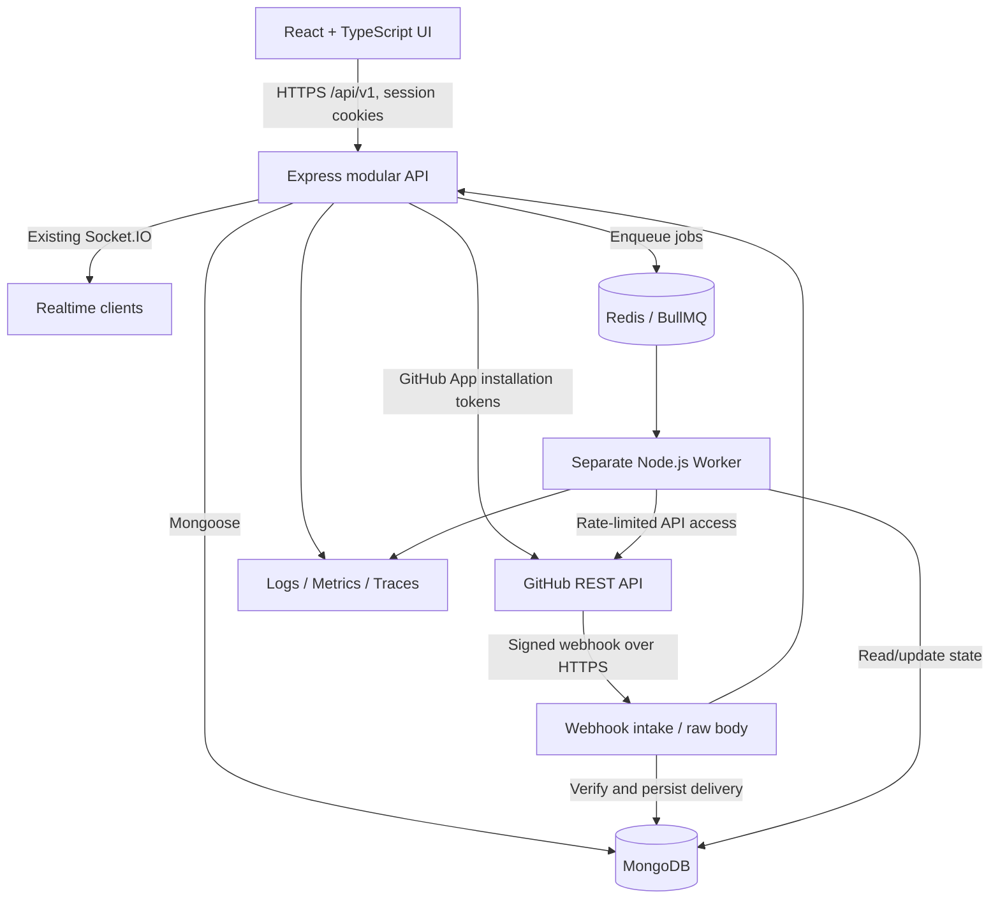
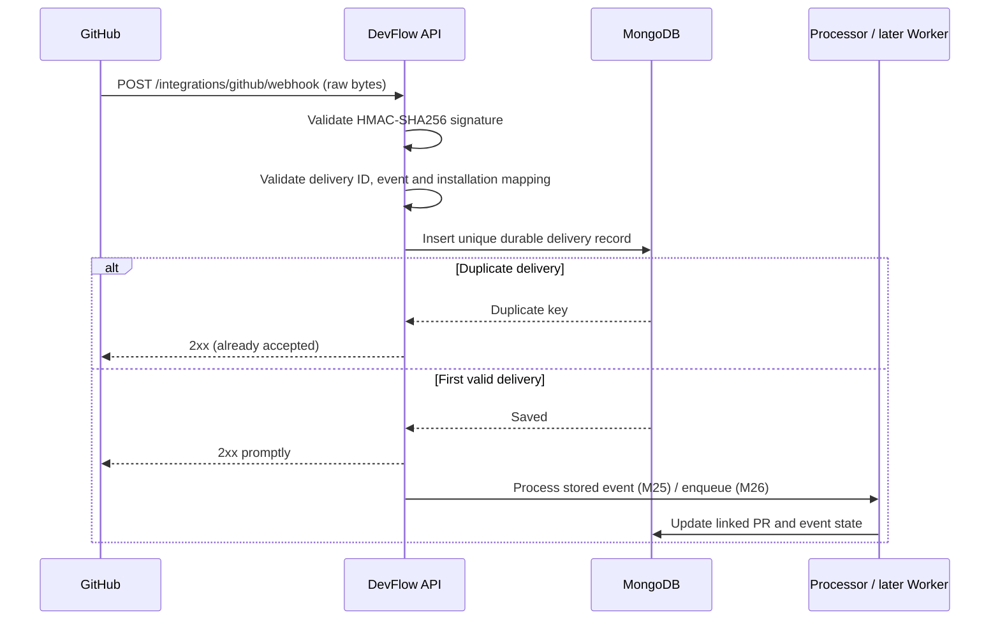
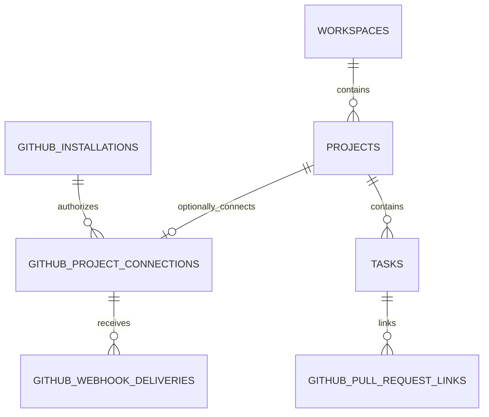
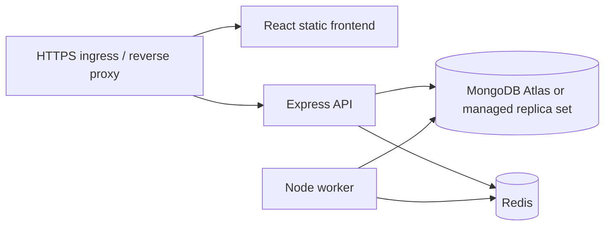

# DevFlow — Stage 3 Technical Design

**Project:** DevFlow  
**Document:** Stage 3 Technical Design Specification  
**Version:** 1.0 — Proposed for approval  
**Date:** 2026-11-27  
**Status:** Draft; not yet approved  
**Prerequisite:** Stage 1 MVP and Stage 2 collaboration features completed  
**Scope:** Previously approved Stage 3 features only

---

## 1. Purpose and boundaries

DevFlow already has a MERN application with authentication, workspaces, projects, tasks, a Kanban board, and the Stage 2 collaboration features (sprints, comments, activity history, real-time updates, notifications, dependencies, and concurrent-editing protection). Stage 3 makes that application easier to integrate, run, update, observe, and maintain.

**Stage 3 includes:** GitHub repository and pull-request integration, webhooks, background processing, measurable performance improvements, advanced reporting, Docker, CI/CD, production monitoring, and a production release.

**Stage 3 does not include:** replacing the MERN stack, rebuilding Stage 1/2, creating microservices, hosting Git repositories, creating a code editor, adding billing, adding AI coding features, building native mobile apps, or promising support for millions of users.

**Design principle:** preserve approved business rules and the existing `docs/UI_UX_DESIGN.md`; new integration screens must use the same visual system.

### 1.1 Starting checkpoint (before changing code)

Because this document is based on the approved plans rather than an audit of the current repository, verify the actual Stage 2 implementation first:

- [ ] Record versions of Node.js, React, Express, Mongoose, MongoDB, and Socket.IO.
- [ ] Confirm the Stage 2 test suite passes and document existing failures.
- [ ] Confirm the current database collections, indexes, and migrations or scripts.
- [ ] Identify how notification delivery, real-time updates, and background tasks currently work.
- [ ] Check current deployment, hosting restrictions, secrets, and GitHub repository settings.
- [ ] Confirm the existing API prefix and the authorization mechanisms.
- [ ] Create a release tag or recoverable snapshot for the Stage 2 baseline.

Do not silently assume the repository matches the old planning documents. If it differs, document the difference and propose the smallest safe change.

## 2. Overall architecture

**Choice:** keep the existing **modular monolith**: one React frontend, one Express API, one MongoDB database. Add a separate Node.js worker process and Redis when M26 begins. GitHub is an external system, not another DevFlow service.



*The webhook receiver is a route in the Express API, not a new public microservice. The diagram shows the eventual M26 design; Redis and the worker are not required in M24–M25.*

### 2.1 Components and responsibilities

| Component | Responsibilities | Must not do |
|---|---|---|
| React | Repository connection screens, linked PR details, analytics charts, existing UI | Store GitHub App private keys, bypass authorization |
| Express | Authenticate DevFlow users, authorize project actions, call integrations, receive webhooks, expose APIs | Perform long webhook processing before acknowledging |
| MongoDB | Store DevFlow data, installation/project links, PR links, durable webhook receipts | Store raw private keys or unencrypted tokens unnecessarily |
| GitHub App | Scoped repository access, installation authorization, webhooks | Receive broader permission than needed |
| Redis/BullMQ | Deliver delayed/retryable jobs | Become the only durable record of accepted webhook events |
| Worker | Process GitHub updates, eligible notifications, and other slow tasks | Serve browser traffic |
| Monitoring | Collect safe operational data and report failures | Expose credentials or private task content |

### 2.2 Code organization (suggested, adapt to the repository)

```text
backend/src/
  modules/
    github/
      github.routes.ts
      github.controller.ts
      github.service.ts
      github.adapter.ts
      github.repository.ts
      github.webhook.ts
    analytics/
      analytics.routes.ts
      analytics.service.ts
      analytics.repository.ts
    ...existing-stage-1-and-2-modules/
  infrastructure/
    queue/
    logging/
    metrics/
    health/
  worker/
    index.ts
    processors/
    schedulers/
frontend/src/features/
  github/
  analytics/
  ...existing-features/
infra/
  docker/
  compose/
.github/workflows/
docs/stage3/
```

Only create the files needed for the current milestone; do not generate empty layers merely to follow this example.

---

## 3. M24 — GitHub integration design

### 3.1 Chosen integration model

Use a **GitHub App**, rather than asking users to paste personal access tokens into DevFlow. The App is installed into a chosen GitHub account and granted access to selected repositories. Its installation tokens are created server-side and used for supported API calls.

For Stage 3, request only the permissions needed to list repository metadata and read pull-request information. Confirm the exact permission names and event subscriptions against GitHub documentation during registration. Do not request repository write permission unless a separately approved use case requires it.

**Important trust rule:** a DevFlow user cannot connect an arbitrary `installationId` or `repositoryId` just because they know it. The backend must establish that the user is authorized to manage the DevFlow project *and* is entitled to connect the selected GitHub installation/repository, using a verified GitHub App user-authorization or installation-linking flow. Bind redirects to a signed, single-use state value. Recheck installation and repository access with GitHub before saving the link.

### 3.2 User flow

1. An authorized Owner or assigned Project Manager opens **Project Settings → GitHub**.
2. They select **Connect GitHub** and go through the GitHub App installation/authorization flow.
3. DevFlow validates callback state and the user's ability to manage the installation.
4. DevFlow fetches repositories accessible to that installation.
5. The user selects one repository for that DevFlow project.
6. DevFlow stores the verified connection; the UI shows the repository and connection health.
7. Authorized project members can view linked pull requests on tasks.
8. The Owner/assigned Manager can disconnect the repository; DevFlow stops new synchronization and makes historical links read-only or removes them according to a documented policy.

**Initial mapping:** one connected GitHub repository per DevFlow project. This is a Stage 3 implementation constraint, not a new Stage 1/2 business rule. If multiple projects legitimately need the same repository, implement unambiguous routing rather than guessing which task a webhook belongs to.

### 3.3 Pull-request linking

- A project member may select a pull request from the connected repository and link it to a task they may view/edit under existing DevFlow permissions.
- Record the GitHub repository ID, pull-request number and stable GitHub PR ID, URL, title, state, and last synchronization time.
- Validate the selected pull request through GitHub before creating the link.
- Provide a view of linked PRs in the existing task-details UI.
- A merged pull request **does not automatically mean the DevFlow task is Done**. Existing manager approval rules still apply.
- Avoid copying code, diff content, or credentials into DevFlow; this feature is a link and activity view.

### 3.4 Failure handling

Handle expired installation tokens, revoked installations, insufficient GitHub permissions, removed repositories, GitHub API rate limits, and temporary network errors. Show a clear *connection needs attention* state rather than hiding failures.

---

## 4. M25 — Webhook design and event flow

### 4.1 Webhook events

Initially subscribe to the specific `pull_request` events required to keep linked pull requests up to date; include installation lifecycle events if required to detect removal or suspension. Avoid subscribing to all GitHub events. Write the event/action allowlist explicitly in code and tests.

### 4.2 Secure intake flow



**Must implement:**

- Receive the **raw request body** before generic JSON parsing changes its bytes.
- Calculate HMAC-SHA256 using the configured webhook secret and compare to `X-Hub-Signature-256` with a timing-safe comparison.
- Reject absent/invalid signatures and enforce a reasonable request-size limit.
- Read GitHub's delivery identifier (`X-GitHub-Delivery`) and use a unique index to prevent duplicate effects.
- Check that installation and repository IDs belong to a verified DevFlow project connection.
- Persist the accepted event or enough recoverable metadata durably **before** returning success; acknowledge quickly, targeting GitHub's current 10-second limit.
- Validate event type and action. Ignore unsupported events safely with a recorded outcome.
- Reconcile current PR state using GitHub when necessary because events may arrive out of order.
- Store only required fields; do not log raw payloads containing potentially private content.
- Provide a way to retry failed *stored* deliveries without replaying unsafe side effects.

### 4.3 M25 → M26 transition

At M25, use a small, controlled processor that reads durable delivery records and updates linked PRs. At M26, move this processing to BullMQ workers. **Never depend on `queue.add()` alone after acknowledging a webhook:** keep a recoverable MongoDB record and a scheduled re-enqueue/reconciliation mechanism for accepted events that were not processed.

### 4.4 Idempotency and ordering

A webhook might be delivered more than once. Each delivery must have one effective outcome. Deduplicate using its stable delivery ID; make downstream updates idempotent as well because a queue job can retry. Before overwriting a PR's state, compare event freshness or fetch the current authoritative state from GitHub. Never let an old `opened` delivery overwrite a newer merged state.

---

## 5. New Stage 3 database collections

**Do not modify or replace the approved Stage 1/2 collections merely to add integration metadata.** Add these supporting collections only as each feature becomes necessary. Names below are proposals to confirm against existing repository naming conventions.

| Collection | Main fields | Main indexes / constraints |
|---|---|---|
| `github_installations` | `installationId`, `accountId`, `accountLogin`, `status`, `lastCheckedAt` | Unique `installationId` |
| `github_project_connections` | `projectId`, `workspaceId`, `installationId`, `repositoryId`, `repositoryFullName`, `status`, `connectedBy`, `connectedAt` | Unique `projectId`; indexes on `installationId`, `repositoryId`, `workspaceId` |
| `github_pull_request_links` | `taskId`, `projectId`, `repositoryId`, `githubPrId`, `number`, `url`, `title`, `state`, `mergedAt`, `syncedAt` | Unique (`taskId`, `githubPrId`); index `repositoryId + githubPrId` |
| `github_webhook_deliveries` | `deliveryId`, `installationId`, `repositoryId`, `event`, `action`, `status`, `attemptCount`, `receivedAt`, `processedAt`, `errorCode`, `minimalPayload` | Unique `deliveryId`; index `status + receivedAt` |
| `job_outbox` *(only if needed)* | `type`, `aggregateId`, `payloadRef`, `status`, `createdAt`, `publishedAt` | Index `status + createdAt`; unique deduplication key where needed |

### 5.1 Relationships and security



The existing `workspaces`, `projects`, and `tasks` remain the source of permission checks. `workspaceId` on an integration record is a convenient scope key but must remain consistent with the parent project. Create/update integrations only after checking the current project's authorization and repository access.

### 5.2 Data retention

Define a limited retention period for full or minimal event payloads and detailed error data. Keep only what is necessary to diagnose delivery failures and avoid storing GitHub secrets, installation access tokens, or source code. If encrypted user authorization credentials are required, store them securely outside ordinary application documents wherever possible; document rotation and revocation.

---

## 6. Proposed Stage 3 REST API additions

Keep the existing `/api/v1` prefix and its JSON/error conventions. The routes below **extend**, but do not change, the previously approved Stage 1/2 contracts. Final request/response schema IDs should be documented before coding M24.

| Method | Route (under `/api/v1`) | Authorization | Purpose |
|---|---|---|---|
| GET | `/integrations/github/setup?projectId=...` | Owner/assigned Manager | Begin verified GitHub App linking; returns setup URL/state |
| GET | `/integrations/github/callback` | Valid signed state and GitHub authorization | Complete verified linking flow; return safely to frontend |
| GET | `/integrations/github/repositories?installationId=...` | Authorized linking session | List accessible repositories |
| GET | `/projects/:projectId/github/connection` | Project reader | View connection status |
| POST | `/projects/:projectId/github/connection` | Owner/assigned Manager + verified installation | Connect a selected repository |
| DELETE | `/projects/:projectId/github/connection` | Owner/assigned Manager | Disconnect repository |
| GET | `/tasks/:taskId/github/pull-requests` | Authorized task reader | List linked PRs |
| POST | `/tasks/:taskId/github/pull-requests` | Authorized project member under task rules | Link an accessible PR |
| DELETE | `/tasks/:taskId/github/pull-requests/:linkId` | Authorized project member under task rules | Unlink PR |
| POST | `/integrations/github/webhook` | Public endpoint; **GitHub HMAC required** | Receive delivery |
| GET | `/projects/:projectId/analytics` | Authorized project reader | Advanced project/sprint statistics |

**Do not** treat `/integrations/github/callback` as evidence of authorization by itself. Its state, GitHub identity/installation authorization, selected project, and expiry must all be validated before a connection can be saved. Use redirects that do not expose sensitive tokens. No DevFlow session cookie or CSRF token is sent to GitHub as a credential.

### 6.1 Response and error rules

- Continue returning `{ "data": ... }` for success and the existing structured error format.
- Return `401` for missing DevFlow authentication, `403` for forbidden actions, `404` for hidden/nonexistent resources, `409` for conflicting links, and `429` or a suitable integration error when external rate limits are reached.
- Return a clear `connection_status` or similar field when a previously linked installation has been revoked.
- Never expose private GitHub installation credentials to the React client.
- Public webhook routes use signature validation instead of normal DevFlow cookie/CSRF authentication; scope the CSRF exemption *only* to this signed webhook endpoint.

---

## 7. M26 — Redis and BullMQ worker design

### 7.1 Why introduce background jobs?

HTTP requests should respond promptly. Work that can be safely completed later should run outside the request handler. Examples within the **approved scope** include GitHub webhook processing, GitHub API synchronization, and existing Stage 2 notification delivery where it currently blocks requests.

### 7.2 Queue structure

Suggested queue names:

- `github-events` — apply previously verified, durable webhook events.
- `github-sync` — reconcile pull-request information.
- `notifications` — move suitable existing notification delivery off the request path.

Each job contains references and small identifiers, not passwords, large private payloads, or API tokens. Workers retrieve the necessary data securely from MongoDB.

### 7.3 Reliability requirements

- Configure bounded retries and exponential backoff for temporary failures; avoid retrying permanent errors forever.
- Make workers idempotent: a retry must not duplicate a notification or overwrite correct PR state.
- Give jobs stable deduplication identifiers where useful, but do not rely solely on a queue job ID for durable business correctness.
- Keep failed-job information and provide a controlled retry method.
- Record events durably before enqueueing and have a reconciliation process for unqueued/unprocessed events.
- Configure Redis persistence, authentication, and an eviction policy compatible with the queue; monitor memory and backlog.
- Implement graceful shutdown and worker health reporting.
- Keep the application useful if Redis is temporarily unavailable: regular project/task CRUD must not depend on the queue. Queue-dependent work can be delayed and recovered.

### 7.4 Testing failure cases

Test worker crashes, Redis restarts, duplicate jobs, network errors, GitHub rate limiting, partial MongoDB updates, job replays, and out-of-order webhooks.

---

## 8. M27 — Performance and scalability design

### 8.1 Measure before optimizing

Take a baseline on a recorded machine/environment and database dataset. Measure:

- API response-time percentiles (p50 and p95), not only averages.
- Requests per second and error rate.
- Database query time and MongoDB `explain` plans.
- Socket.IO connection count and update latency (Stage 2 feature).
- Job queue waiting time, processing duration, and failure/retry count.
- CPU, memory, and Node.js event-loop delay.

Use repeatable load-test scenarios such as **login, list projects, filter tasks, open a Kanban board, fetch dashboards, and apply valid task updates**. Test a realistic mixture of reads and writes. Document simulated user counts, hardware, and rate limits; do not claim production scalability based on a single laptop test.

### 8.2 Optimization order

1. Fix clearly slow database queries and missing indexes.
2. Avoid N+1 reads, oversized payloads, and unnecessarily repeated API calls.
3. Apply correct pagination, field projection, and efficient aggregation.
4. Check frontend request caching and refetch rules.
5. Introduce Redis caching **only** for proven hot read paths and define invalidation rules.
6. Re-test and compare results; keep only improvements supported by data.

If multiple API instances are deployed, review the Stage 2 Socket.IO broadcast/session topology. Add an appropriate cross-instance adapter and connection-routing strategy only if horizontal scaling is actually used and tested.

### 8.3 Suggested acceptance evidence

For at least three key user workflows, provide before/after p50, p95, error rate, throughput, environment, and dataset size. Success is **measurable improvement or a documented explanation of why no change was necessary**, not an invented performance number.

---

## 9. M28 — Advanced analytics design

Use existing Stage 1 tasks and Stage 2 sprints/activity records. Possible approved Stage 3 reports:

- Task completion count by day/week.
- Sprint completion percentage and carryover count.
- Tasks created vs. tasks completed over time.
- Work in progress by status.
- Current workload by assignee, from active assignments.
- Project-level trends and comparisons across date ranges.

Define every metric precisely. Example:

**Sprint completion rate** = number of sprint tasks completed by the sprint end / number of tasks committed when the sprint started × 100. This metric requires either a reliable commitment snapshot in Stage 2 or a documented fallback; **do not pretend the current sprint membership equals the original commitment**.

**Reporting rules:**

- Reuse existing task/sprint access permissions; authorized project members see only accessible project reports.
- Avoid presenting workload metrics as a definitive judgment about developer quality.
- Use MongoDB aggregations and suitable indexes; do not create duplicate counters until the measurements justify them.
- Ensure date boundaries and time zones match the conventions already used in Stage 1/2.
- Empty projects and sprints must show clear zero/empty states.
- Use the approved Studio Light/Studio Dark design language.

---

## 10. M29 — Docker and environments

### 10.1 Environments

- **Local:** easy development and testing; MongoDB must support the transactions already used by Stage 1.
- **CI:** isolated test services; no access to production secrets or data.
- **Staging:** production-like configuration for final verification.
- **Production:** HTTPS, real credentials, persistent storage, backups, monitoring.

### 10.2 Container layout



Create Dockerfiles for the frontend delivery approach, API, and worker. Use multi-stage builds and non-root users when supported. Create Docker Compose definitions for local development with persistent volume(s) where needed, internal networks, and health checks. If using a managed MongoDB service in staging/production, do not also launch an unnecessary database container there.

### 10.3 Configuration and secrets

- Document `.env.example` without real credentials.
- Inject credentials through secure environment/secret facilities; never bake them into images.
- Do not expose MongoDB or Redis ports to the public internet.
- Keep separate secrets and database names for local, CI, staging, and production.
- Test clean startup, shutdown, recreation, and recovery after a service restart.

---

## 11. M30 — CI/CD pipeline

### 11.1 Continuous Integration (CI)

On each pull request, run independent checks where possible:

1. Install dependencies from a locked dependency file.
2. Lint and format check.
3. TypeScript type checks.
4. Unit tests.
5. Integration tests using isolated test services.
6. Frontend and backend build.
7. Selected security/dependency checks.
8. Optional targeted E2E tests against a test environment.

Require successful checks before merging protected branches. Use least-privilege `GITHUB_TOKEN` permissions, pin third-party actions to verified commit SHAs, and avoid running untrusted pull-request code with production secrets.

### 11.2 Continuous Delivery / Deployment (CD)

For an approved branch or release tag:

1. Reuse the tested build artifact or produce a versioned image.
2. Deploy to staging.
3. Run health checks and smoke tests, including login, task management, Socket.IO, and integration health.
4. Require an explicit production approval gate where available.
5. Deploy the versioned artifact to production.
6. Verify post-deploy health, metrics, and error rate.
7. Roll back to the previous known-good image/release when necessary.

Cloud provider selection remains an implementation decision. The selected hosting must support the existing real-time connections, always-on worker needs, secure secrets, and a supported MongoDB topology.

---

## 12. M31 — Monitoring, operations, and security

### 12.1 Observability

Implement:

- Structured logs with timestamp, level, service, request/correlation ID, route, safe error code, and latency.
- Liveness and readiness checks: API running is different from API ready to serve real requests.
- Application metrics: request latency/error rates, active real-time connections, queue backlog, job failures, webhook processing age, database availability.
- Traces for selected expensive paths if worthwhile; OpenTelemetry can be used but is not mandatory to meet the concept.
- Error reporting and alerts for failures affecting user workflows.

**Never log:** passwords, session cookies, CSRF values, GitHub App private keys/tokens, raw reset links, or complete private payloads.

### 12.2 Security review

Verify:

- Existing session, CSRF, rate-limit, RBAC, and workspace-isolation controls still pass.
- GitHub App permissions are minimal and revoked installations stop working.
- Webhook raw-body signatures, IDs, and event routing are validated.
- GitHub API requests target documented trusted hosts and reject unsafe redirects/SSRF-style inputs.
- The API, worker, MongoDB, and Redis use appropriate networking, encryption, and secret rotation.
- Container dependencies and CI actions are reviewed and kept current.
- Backups and at least one restore rehearsal are documented.

### 12.3 Production release checklist

- [ ] CI and smoke tests pass.
- [ ] Project and task workflows still pass.
- [ ] Stage 2 live updates, notifications, sprints, and dependencies pass.
- [ ] GitHub install/connect/link and webhook flows pass.
- [ ] Webhook duplicates/replays do not cause repeated effects.
- [ ] Worker can recover jobs after a restart.
- [ ] HTTPS, secret handling, backups, and monitoring are confirmed.
- [ ] Rollback plan tested.
- [ ] Deployment and incident-response instructions written.
- [ ] Stage 3 tag/release notes created with actual measured results.

---

## 13. Quality targets and test matrix

These are **proposed engineering acceptance checks**, not promises of a specific traffic capacity.

| Area | Test | Passing evidence |
|---|---|---|
| GitHub linking | Unauthorized DevFlow member tries to connect repo | Denied; existing RBAC intact |
| GitHub authorization | Forged installation/repository ID or callback state | Rejected; no connection stored |
| GitHub revocation | App removed or repository access removed | Connection marked unavailable, no unauthorized sync |
| Webhook security | Invalid/missing HMAC signature | Rejected before processing |
| Webhook reliability | Same GitHub delivery sent twice | Single effective update |
| Webhook ordering | Old event follows new event | Current authoritative state preserved |
| Queue recovery | Worker or Redis restarted | Accepted durable events eventually recover |
| Performance | Repeatable tests before/after | Document p95, throughput, errors, environment |
| Analytics | Test known task/sprint dataset | Accurate results and boundary handling |
| Docker | Fresh clean environment | Full stack starts with documented instructions |
| CI | Open PR with intentionally broken test | CI fails and blocks merge as configured |
| CD | Fault injected after deployment | Health checks detect it; rollback documented |
| Security | Cross-workspace requests | Denied across new and existing endpoints |
| Monitoring | Simulated job/webhook failure | Error identifiable by request/delivery/job ID |

### 13.1 Suggested test tools

Reuse existing Vitest, Supertest, and Playwright. Add a repeatable load-testing tool (for example, k6) only for M27. Prefer Testcontainers or isolated CI service containers for Redis and MongoDB integration tests. Mock GitHub responses in most tests; keep a small separate end-to-end test using a dedicated GitHub test installation.

---

## 14. Engineering trade-offs and interview preparation

| Decision | Why chosen | Alternative/trade-off |
|---|---|---|
| GitHub App | Scoped repository access and webhook integration | User PATs are simpler initially but harder to manage securely |
| Modular monolith | Keeps existing code and mental model | Microservices would add deployment/network complexity |
| Durable webhook delivery record | Enables retries and deduplication | Queue-only intake risks lost work when enqueue fails |
| BullMQ worker | Retries and separates slow work from HTTP | Direct processing simpler but harms responsiveness/recovery |
| Cache only after profiling | Prevents invalidation complexity without benefit | Cache-everything creates stale data risk |
| Derived analytics | Consistent with actual tasks and sprints | Precomputed counters are faster but harder to keep correct |
| Docker/Compose | Reproducible multi-process setup | Manual machine setup is more fragile |
| CI/CD approval gates | Reduces unsafe production deployments | Fully automatic deployment may be faster but riskier |

You should be able to explain **why** each choice was made, how it fails, how it recovers, what it costs, and which measurements support it.

---

## 15. Decisions to confirm at implementation time

These do **not** change the approved Stage 3 product scope:

1. Actual Stage 2 architecture and naming after repository audit.
2. GitHub App setup/authorization callback details and minimum permissions, based on current GitHub APIs.
3. Hosting provider and whether MongoDB/Redis are managed or self-hosted.
4. Performance test dataset, hardware, and measurable service objectives.
5. Monitoring provider (or self-hosted approach) and data retention policies.
6. A precise policy for how historical PR links appear after a repository disconnect.

Record choices in short Architecture Decision Records (ADRs), with reasons and alternatives.

---

## 16. Official technical references (verified November 2026)

- GitHub Apps and installation authentication: https://docs.github.com/en/apps/creating-github-apps/authenticating-with-a-github-app/authenticating-as-a-github-app-installation
- GitHub App permissions: https://docs.github.com/en/apps/creating-github-apps/registering-a-github-app/choosing-permissions-for-a-github-app
- GitHub webhook signature validation: https://docs.github.com/en/webhooks/using-webhooks/validating-webhook-deliveries
- GitHub webhook best practices: https://docs.github.com/en/webhooks/using-webhooks/best-practices-for-using-webhooks
- BullMQ idempotent jobs: https://docs.bullmq.io/patterns/idempotent-jobs
- BullMQ production guidance: https://docs.bullmq.io/guide/going-to-production
- Docker Compose: https://docs.docker.com/compose/
- GitHub Actions security: https://docs.github.com/en/actions/how-tos/secure-your-work
- OpenTelemetry for JavaScript: https://opentelemetry.io/docs/languages/js/

---

**Document status:** Draft awaiting user approval. Stage 3 implementation should follow this design only after confirming it against the actual Stage 2 repository.
